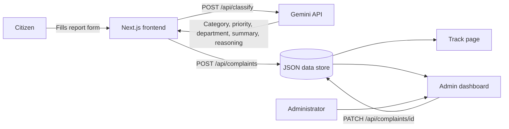

# CivicResolve

### AI-Powered Citizen Grievance Management and Resolution

**Report. Track. Resolve.**

CivicResolve is an AI-powered civic issue reporting and management platform. Citizens report problems like potholes, overflowing garbage bins, broken streetlights and water leakage through a simple form. **Google Gemini** reads each report, identifies the category, detects how urgent it is, and recommends the municipal department that should handle it. Citizens can then follow the complaint from **Reported** to **In Progress** to **Resolved**, while administrators review and manage every complaint from one dashboard.

Built for the **Google for Developers "Build with AI" Challenge** (PromptWars x GDGoC PSG iTech) using **Google Gemini** and **Google Antigravity**.

| | |
|---|---|
| **Live demo** | https://civic-resolve-agb7.onrender.com |
| **Source code** | https://github.com/dekasri-karthic/civicresolve |

> **Note:** the demo runs on a free hosting tier that goes to sleep when idle. If the first page load takes about a minute, the server is waking up. Reload and it will be fast.

---

## Table of contents

1. [The problem](#the-problem)
2. [The solution](#the-solution)
3. [Features](#features)
4. [How Gemini is used](#how-gemini-is-used)
5. [Architecture](#architecture)
6. [Tech stack](#tech-stack)
7. [Project structure](#project-structure)
8. [Getting started](#getting-started)
9. [Deployment](#deployment)
10. [Testing](#testing)
11. [Security](#security)
12. [Accessibility and responsive design](#accessibility-and-responsive-design)
13. [Limitations and future improvements](#limitations-and-future-improvements)
14. [How this meets the challenge](#how-this-meets-the-challenge)
15. [Built with](#built-with)

---

## The problem

Everyday civic issues such as potholes, overflowing garbage bins, damaged streetlights, water leakage and poor road conditions affect whole communities. Reporting them is often confusing and disconnected:

- Citizens do not know **which department** is responsible.
- It is hard to **describe the issue** in a way authorities can act on.
- There is **no visibility** into what happens after a complaint is filed.
- Authorities receive unstructured complaints that are hard to **categorize and prioritize**.

## The solution

CivicResolve removes that friction with AI-assisted reporting and transparent tracking:

1. **A citizen reports an issue** with a title, description, location and an optional photo.
2. **Gemini analyzes the report** and returns the category, priority, recommended department, a one-line summary and its reasoning.
3. **The citizen reviews the AI analysis**, edits it if needed, and files the complaint. It is saved with the status **Reported** and a unique complaint ID.
4. **Everyone can track progress** on the Track page, from Reported to In Progress to Resolved.
5. **Administrators manage complaints** from the admin dashboard: filter, review and update statuses.

---

## Features

### 1. Landing page

A clean, mobile-friendly home page that explains the platform in three steps (report, AI categorizes, track and resolve) and gives direct access to reporting, tracking and the admin portal.


### 2. Citizen issue reporting

Citizens submit a complaint through a simple form:

- **Title** and **description** of the problem
- **Location** (street, landmark or area)
- **Category** dropdown, including a **"Let AI decide"** option
- **Optional photo** upload with a live preview (JPG, PNG or WebP, up to 5 MB)
- Friendly validation messages for missing fields and invalid files

### 3. AI-powered classification

After the citizen submits the form, Gemini analyzes the complaint and automatically identifies one of the following categories:

`Road & Potholes` · `Garbage & Sanitation` · `Street Lighting` · `Water Supply & Leakage` · `Drainage & Sewage` · `Public Safety` · `Other`

### 4. Priority detection

Every issue is classified as **Low, Medium, High or Critical** based on public safety risk, the number of people likely to be affected and how urgent the problem is. For example, exposed live wires or an open drain on a school route are rated higher than a faded road marking. Priority is shown as a color-coded badge (green, yellow, orange, red) with a text label.

### 5. Department recommendation

Gemini recommends the department that should handle the issue (for example Public Works, Sanitation, Electricity Board or Water Board), so citizens never need to guess where a complaint should go.

### AI analysis card

Before a complaint is saved, the citizen sees an **AI Analysis card** with the category, priority, recommended department, a one-line summary and Gemini's reasoning. The citizen can **review and edit** the category and priority before confirming. The card also shows whether the result came from **Gemini** or from the built-in fallback classifier, so the source is always transparent.


After confirming, the citizen sees a success screen with the **complaint ID**, the assigned department and a link to track the issue.

### 6. Issue tracking dashboard

The Track page shows every submitted complaint as a card with:

- Title, location, category and recommended department
- Priority badge and status chip
- A **three-step progress indicator**: Reported, In Progress, Resolved
- An expandable **AI reasoning** section that explains why the issue got its category and priority
- **Search** by title, location or complaint ID
- **Status filters** with counts (All, Reported, In Progress, Resolved) and category filters


### 7. Admin dashboard

Administrators get a dedicated dashboard at `/admin` to manage reported issues:

- A table of all complaints with ID, title, location, category, priority, department, status and date
- **Filters** by status and priority, with a clear-filters button
- A **status dropdown** on every row to move a complaint through Reported, In Progress and Resolved
- A confirmation message after each update, and a friendly error if an update fails
- Changes appear on the citizen Track page immediately


### Bonus features

These extras make the platform more useful beyond the core requirements.

- **Suggested action and estimated resolution time:** the AI card goes beyond classification and tells the department what to do and roughly how long it should take.
- **Open in Maps:** each complaint has a link that opens its location in Google Maps, helping field teams find the spot.
- **Admin summary stats:** cards at the top of the admin page show Total, Reported, In Progress, Resolved and High/Critical counts at a glance.
- **Multilingual complaints:** citizens can write in their own language and Gemini still understands the issue, returning the analysis in English for the department.
- **Realistic sample data:** a seed script adds sample complaints from cities across India, covering every category, priority and status, so the app is useful the moment it starts.
- **Reliable fallback:** if Gemini is unavailable, a keyword-based classifier takes over so reporting never breaks.

---

## How Gemini is used

All AI work runs **server-side** using the official `@google/genai` SDK.

| Aspect | Details |
|---|---|
| **Model** | Configurable through the `GEMINI_MODEL` environment variable (default: `gemini-3.8-flash`) |
| **Endpoint** | `POST /api/classify` |
| **Input** | Title, description, location and the optional user-selected category |
| **Output** | Structured JSON: `category`, `priority`, `department`, `summary`, `reasoning` |
| **Structured output** | A strict JSON schema is requested, so the response can be parsed reliably |
| **Validation** | The response is checked against the allowed categories and priority levels before it is used |
| **Fallback** | On any failure, timeout or invalid output, a keyword classifier returns a sensible result and the card is labeled as a basic analysis |
| **Transparency** | Every result records its `source` (`gemini` or `fallback`), shown on the AI card |

---

## Architecture



**API routes**

| Route | Purpose |
|---|---|
| `POST /api/classify` | Sends a complaint to Gemini and returns the analysis (with fallback) |
| `GET /api/complaints` | Returns all complaints, newest first |
| `POST /api/complaints` | Saves a new complaint and its optional image |
| `PATCH /api/complaints/[id]` | Updates a complaint's status (used by the admin dashboard) |

---

## Tech stack

| Layer | Technology |
|---|---|
| Framework | Next.js (App Router) |
| Language | TypeScript |
| Styling | Tailwind CSS |
| Icons | lucide-react |
| AI | Google Gemini via `@google/genai` |
| Storage | JSON file data layer (`data/complaints.json`) for a zero-setup prototype |
| Hosting | Render |
| Built with | Google Antigravity |

---

## Project structure

```text
civicresolve/
├── app/
│   ├── api/
│   │   ├── classify/route.ts          # Gemini classification + fallback
│   │   └── complaints/
│   │       ├── route.ts               # List and create complaints
│   │       └── [id]/route.ts          # Update complaint status
│   ├── admin/page.tsx                 # Admin dashboard
│   ├── report/page.tsx                # Citizen report form + AI analysis card
│   ├── track/page.tsx                 # Public tracking page
│   ├── layout.tsx                     # Global layout and navigation
│   └── page.tsx                       # Landing page
├── components/                        # PriorityBadge, StatusBadge, ProgressBar, ...
├── lib/
│   ├── gemini.ts                      # Server-side Gemini client + fallback logic
│   ├── db.ts                          # JSON data layer
│   └── types.ts                       # Shared TypeScript types
├── scripts/seed.ts                    # Adds realistic sample complaints
├── data/complaints.json               # Complaint storage
├── public/uploads/                    # Uploaded issue photos
├── docs/screenshots/                  # README screenshots
├── .env.example                       # Example environment variables
└── package.json
```

---

## Getting started

### Prerequisites

- Node.js 20.9 or newer (Node 22 recommended)
- A free Gemini API key from [Google AI Studio](https://aistudio.google.com)

### Run locally

```bash
# 1. Clone the repository
git clone https://github.com/dekasri-karthic/civicresolve.git
cd civicresolve

# 2. Install dependencies
npm install

# 3. Create your environment file
cp .env.example .env.local
# then open .env.local and add your Gemini API key

# 4. (Optional) Add the sample complaints
npm run seed

# 5. Start the development server
npm run dev
```

Open **http://localhost:3000** in your browser.

### Environment variables

| Variable | Description | Example |
|---|---|---|
| `GEMINI_API_KEY` | Your Gemini API key (kept on the server, never sent to the browser) | `your_api_key_here` |
| `GEMINI_MODEL` | The Gemini model used for classification | `gemini-3.8-flash` |

### Useful scripts

| Command | What it does |
|---|---|
| `npm run dev` | Start the development server |
| `npm run build` | Create a production build |
| `npm start` | Run the production build |
| `npm run seed` | Add the sample complaints (safe to run more than once) |

---

## Deployment

The live demo runs on **Render** straight from this GitHub repository.

| Setting | Value |
|---|---|
| Service type | Web Service (Node) |
| Build command | `npm install && npm run build` |
| Start command | `npm start` |
| Environment variables | `GEMINI_API_KEY`, `GEMINI_MODEL`, `NODE_VERSION=22` |

Render redeploys automatically whenever new code is pushed to the `main` branch.

---

## Testing

The prototype was tested end to end in the browser. This is the manual test checklist:

| # | Test | Expected result |
|---|---|---|
| 1 | Submit a text-only report (for example a pothole near a hospital) | AI card shows category, priority, department, summary and reasoning labeled "Analyzed by Gemini" |
| 2 | Confirm and save the complaint | Success screen with a complaint ID; the complaint appears first on the Track page |
| 3 | Upload a photo with a report | Preview shows in the form; the photo is saved with the complaint |
| 4 | Submit an empty form | Friendly validation messages, no crash |
| 5 | Upload an unsupported file type or a file over 5 MB | Clear error message |
| 6 | Search and filter on the Track page | List updates instantly; progress bars match each status |
| 7 | Change a status on the admin dashboard | Confirmation message; the Track page shows the new status |
| 8 | Filter the admin table by priority and status | Only matching complaints are shown |
| 9 | Stop Gemini from responding (for example an invalid key) | Fallback classifier returns a result and the card is labeled as a basic analysis |
| 10 | Open every page at phone width | No horizontal scrolling; layout stays usable |

---

## Security

- The **Gemini API key stays on the server**. All AI calls happen in server-side API routes, so the key is never exposed to the browser.
- Secrets live in `.env.local`, which is **excluded from Git**. Only `.env.example` with placeholder values is committed.
- Uploaded files are **validated by type** (JPG, PNG, WebP) and **limited to 5 MB**.
- AI output is **validated** before it is stored or shown, and any failure falls back safely instead of exposing error details.
- User input is handled through typed API routes with server-side validation.

---

## Accessibility and responsive design

- **Mobile-first, responsive layout** that works on phones, tablets and desktops; tables scroll inside their own container instead of breaking the page.
- Priority and status are shown with **text labels as well as colors**, so meaning does not rely on color alone.
- Form fields have **visible labels** and friendly, specific validation messages.
- Clear **loading states** ("AI is analyzing your report...") and **empty states** keep users informed.

---

## Limitations and future improvements

This is a hackathon prototype built to demonstrate the full workflow end to end. Known limitations and the planned next steps:

| Limitation | Planned improvement |
|---|---|
| Data is stored in a JSON file, and the free hosting tier resets files on restart | Move to a managed database (such as PostgreSQL) and cloud image storage |
| The admin dashboard has no login | Role-based authentication for administrators and municipal staff |
| Photos are stored with the complaint but not yet analyzed by Gemini | Reliable photo-first reporting, where Gemini Vision fills in the issue details from the image |
| No notifications | SMS and email updates when a complaint changes status |
| Duplicate reports are saved separately | Duplicate detection that merges reports about the same issue and raises priority as reports increase |
| No map view or analytics | Live map of issues and analytics for hotspots and resolution times |

---

## How this meets the challenge

| Expected feature | How CivicResolve delivers it |
|---|---|
| Citizen issue reporting | Report form with title, description, location, category and optional photo |
| AI-powered classification | Gemini identifies the category automatically ("Let AI decide") |
| Priority detection | Low, Medium, High and Critical based on safety risk, impact and urgency |
| Department recommendation | Gemini recommends the responsible municipal department |
| Issue tracking dashboard | Track page with status chips, search, filters and a three-step progress indicator |
| Admin dashboard | Admin page to review complaints, filter them and update statuses |

---

## Built with

- [Google Gemini](https://ai.google.dev) for classification, prioritization and routing
- [Google Antigravity](https://antigravity.google) for agentic development
- [Next.js](https://nextjs.org), [TypeScript](https://www.typescriptlang.org) and [Tailwind CSS](https://tailwindcss.com)

**Author:** Dekasri Karthic

*Built for the Google for Developers "Build with AI" Challenge, PromptWars x GDGoC PSG iTech.*
